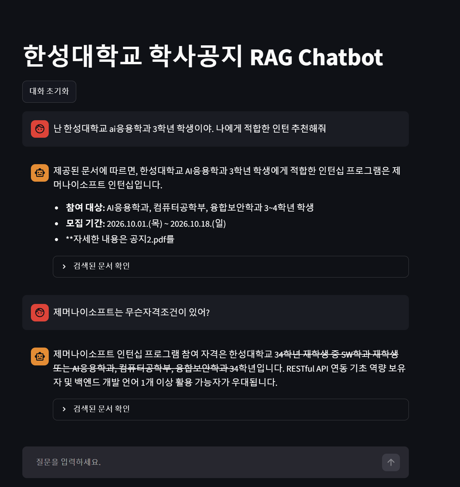

# 실행 및 결과

환경은 Windows 11, Python 3.11.15, Ollama 0.40.4, gemma3:4b, streamlit 1.65.0이다. 모든 명령은 가상환경을 켠 상태에서 `C:\2026-open\7w`에서 실행했다.

```powershell
cd C:\2026-open\7w
.\.venv\Scripts\Activate.ps1
```

## step1. Ollama 연결

```powershell
python step1_ollama.py
```

```text
질문:
RAG가 무엇인지 한 문장으로 설명해줘.

답변:
RAG(Retrieval-Augmented Generation)은 검색된 정보를 활용하여 생성 모델의 답변 품질을 향상시키는 기술입니다.
```

파이썬에서 로컬 모델을 부르는 데 성공했다.

## step2. 문서 검색

```powershell
python step2_retrieval.py
```

```text
데이터 폴더:
C:\2026-open\6w\data

문서 불러오기: 공지1.pdf

문서 불러오기: 공지2.pdf

불러온 전체 페이지 수: 4
생성된 Chunk 수: 8

질문:
인턴십 관련 공지의 주요 내용은 무엇인가요?

========== 검색 결과 1 ==========
파일: 공지2.pdf
페이지: 0
(문서 내용 생략: 제머나이소프트 인턴십 참여대상, 모집개요, 담당업무)

========== 검색 결과 2 ==========
파일: 공지2.pdf
페이지: 0
(문서 내용 생략: 면접 전형, 인턴십 기간, 제출서류)

========== 검색 결과 3 ==========
파일: 공지2.pdf
페이지: 0
(문서 내용 생략: 주차별 운영 계획, 학생 혜택, 운영 일정표)
```

PDF 2개(4페이지)가 8개 조각이 되었다. 질문이 인턴십이어서 검색된 조각 3개가 모두 인턴십 공지인 공지2.pdf였다. 3번째 조각에 모집기간 2026.10.01.(목) ~ 2026.10.18.(일)이 들어 있다.

## step3. Basic RAG

```powershell
python step3_basic_rag.py
```

```text
질문:
인턴십 신청 기간은 언제인가요?

검색된 문서:
- 공지2.pdf
- 공지1.pdf
- 공지1.pdf

RAG 답변:
인턴십 신청 기간은 2026년 10월 7일(수) 22:00까지입니다.
```

이 답은 틀렸다. 10월 7일 22:00은 공지1.pdf에 있는 IPP 일학습병행 2차 모집의 이력서 제출기한이다. 인턴십(제머나이소프트) 공지의 실제 모집기간은 2026.10.01 ~ 10.18이다.

원인은 검색이다. 검색된 3개 중 공지2.pdf 조각은 일정표가 아니라 면접 전형과 제출서류 부분이었고, 나머지 2개는 공지1.pdf였다. 정답이 든 일정표 조각이 상위 3개에 들지 못했다. 모델은 받은 문서의 내용을 그대로 읽었을 뿐이라, 받은 문서가 틀리면 답도 틀린다.

### k를 늘려 본 실험

제출 코드는 `k=3`을 그대로 두고, 임시 복사본에서만 `k=5`로 바꿔서 같은 질문을 실행했다.

- 검색된 조각에 `모집기간(이력서 제출) 2026.10.01.(목) ~ 2026.10.18.(일)` 줄이 들어왔다. 정답 조각의 순위가 4~5위였다는 뜻이다.
- 그런데 답변은 여전히 "2026년 10월 7일(수) 22:00까지입니다."였다.

그래서 이 사례는 검색 순위 문제와 생성 문제가 겹쳐서 생겼다. 날짜가 다른 조각이 같이 들어왔을 때 모델이 먼저 나온 조각의 날짜를 골랐다. 개선 방법으로 질문에 "제머나이소프트 인턴십"처럼 대상을 적기, 문서 제목을 조각에 붙이기, 검색 결과를 다시 정렬하는 리랭커, 더 큰 모델 사용을 생각해 볼 수 있다. 이 방법들은 직접 시험해 보지는 않았다.

## step4. 대화형 RAG

교수님 문서의 예시 대화를 입력해서 실행했다.

```powershell
python step4_chat_rag.py
```

```text
대화형 RAG Chatbot
종료하려면 exit를 입력하세요.

사용자:
[검색 Query]
인턴십 관련 정보 알려줘.

AI: 제머나이소프트 인턴십 프로그램에 대한 정보를 제공해 드립니다.

**모집 개요:**

*   **기업:** 제머나이소프트 (서울특별시 마포구 월드컵북로 402, 상암동 케이지아이티센터)
*   **모집 인원:** 4명
*   **인턴십 기간:** 2026년 11월 2일 (월) ~ 

사용자:
[검색 Query]

이전 질문:
인턴십 관련 정보 알려줘.

현재 질문:
그럼 제출 기한은?


AI: 제출 기한은 2026년 10월 18일(일)까지입니다.
```

- 두 번째 질문의 검색 Query에 이전 질문이 들어갔고, 정확한 답("10월 18일")이 나왔다. 이전 질문 없이 "그럼 제출 기한은?"만 검색했다면 무엇의 기한인지 알 수 없다.
- 첫 번째 답변은 "2026년 11월 2일 (월) ~ "에서 끊겼다. 코드의 `num_predict=100` 때문에 100토큰까지만 생성해서 생긴 현상이다.

## app.py. Streamlit

```powershell
streamlit run app.py
```

브라우저에서 `http://localhost:8501`로 접속한다. 처음 접속할 때 PDF를 읽고 임베딩하는 데 시간이 걸리고, 그 뒤로는 캐시된 RAG 환경을 재사용한다.

### 실행 화면



AI응용학과 3학년이라고 밝히고 인턴십을 추천해 달라고 물은 다음, 제머나이소프트의 자격조건을 이어서 물었다.

- 첫 답변은 제머나이소프트 인턴십을 추천하면서 참여 대상(AI응용학과, 컴퓨터공학부, 융합보안학과 3~4학년)과 모집 기간(2026.10.01 ~ 10.18)을 문서 내용대로 말했다.
- 첫 답변의 마지막 줄이 `**자세한 내용은 공지2.pdf를`에서 끊겼다. 앱의 `num_predict=120` 제한 때문이다.
- 두 번째 답변에서 "3~4학년" 부분이 취소선으로 보인다. 모델이 쓴 글에 물결표(~)가 두 번 나왔고 `st.write`가 이를 취소선으로 해석한 것으로 보인다. 내용이 틀린 것이 아니라 화면 표시 문제다.
- 두 번째 답변은 RESTful API 연동 기초 역량과 백엔드 개발 언어를 언급했다. 다만 이 두 항목을 우대사항이라고 했는데, 검색된 문서 조각에는 자격요건 목록으로 적혀 있어서 정확한 표현인지는 확인이 필요하다.

### 화면 없이 시험한 결과

브라우저 화면 외에 Streamlit의 테스트 도구(AppTest)로도 질문을 넣어 보았다. 예외 없이 실행됐고, 질문과 답변이 대화에 저장됐고, 검색 Query와 출처 파일이 함께 저장됐고, 답변이 끝난 뒤 `pending_question`이 비워졌다.

| 질문 | 답변 |
| --- | --- |
| 인턴십 관련 정보 알려줘. | 인턴십 기간은 2026년 11월 2일(월)부터 2026년 12월 11일(금)까지 총 30일입니다. 총 120시간의 실습 지원비가 지급되며, 1인당 80만원을 실습 지원비로 지급하고 비교과 포인트 20P를 지급합니다. 또한 수료증이 발급됩니다. |
| 그럼 제출 기한은? | 이력서 제출 기한은 2026년 10월 18일(일)까지입니다. |

첫 답변에는 "총 120시간의 실습 지원비"처럼 두 항목(총 120시간, 실습지원비 80만원)이 섞인 부정확한 표현이 있다. 작은 모델의 한계로 보인다. 두 번째 답은 정확하다.

질문을 바꿔서 "인턴십 모집 대상이 누구인가요?" 다음에 "그럼 제출 기한은?"을 물었을 때는 이렇게 나왔다.

| 질문 | 답변 |
| --- | --- |
| 인턴십 모집 대상이 누구인가요? | 한성대학교 3~4학년 재학생 중 SW학과 재학생 또는 AI응용학과, 컴퓨터공학부, 융합보안학과 3~4학년입니다. |
| 그럼 제출 기한은? | 제공된 문서에서 확인할 수 없습니다. |

이전 질문이 달라지면 검색되는 조각도 달라져서, 이번에는 일정표 조각이 들어오지 않았다. 모델은 모르는 내용을 지어내지 않고 프롬프트 규칙대로 확인할 수 없다고 답했다. 정답이 문서에 있는데도 못 찾은 것이므로 검색의 한계이기도 하다.
